<p align="center">
  <picture>
    <source srcset=".github/readme/hero.avif" type="image/avif">
    
  </picture>
</p>

<h1 align="center">Deflix</h1>

<p align="center">
  <b>Every streaming service. One home. Built for the couch.</b><br>
  <sub>A cinematic, streaming-style skin for Kodi 21 Omega</sub>
</p>

<div align="center">

<a href="https://unrefundable.github.io/Deflix/">
  
</a>


<a href="LICENSE">
  
</a>

</div>

<p align="center">
  <a href="#installation"><b>Install</b></a> ·
  <a href="#a-hub-for-every-service">Hubs</a> ·
  <a href="#features">Features</a> ·
  <a href="#how-it-works">How it works</a> ·
  <a href="#requirements">Requirements</a> ·
  <a href="#faq">FAQ</a> ·
  <a href="#license">License</a>
</p>

<p align="center">
  
</p>

<p align="center">
  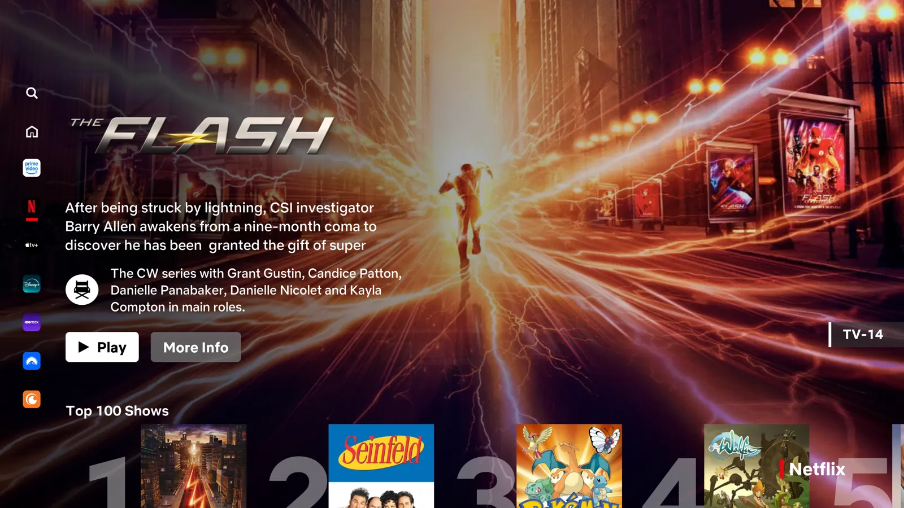
</p>

**Deflix** turns Kodi into the streaming app you already know how to use. A slim sidebar holds a hub for each major service (**Netflix, Prime Video, Apple TV, Disney+, HBO Max, Paramount+ and Crunchyroll**), each in its own colours, with its Top 100, originals, new releases and genres. Home is built from your own Trakt account, so what you were watching is always the first thing you see. Pick a title and press **Play**: no menus, no source lists, no setup screens in the way.

Everything is designed to be driven from the sofa with a TV remote. Big artwork, clear focus, and a title page for every movie and show with the details you actually want: its match score, the cast, the next episode to watch, and more like it.

> [!NOTE]
> Deflix is an unofficial, fan-made skin. It doesn't host, index or provide any content, and it isn't affiliated with Netflix, Amazon, Apple, Disney, Warner Bros. Discovery, Paramount, Crunchyroll, Trakt or TMDb. Service names and logos belong to their owners and are used only to label where a title streams.

<p align="center">
  
</p>

## A hub for every service

Each service gets its own hub, catalogued from TMDb and themed in its own colours, right down to the sidebar.

<table>
  <tr>
    <td width="50%" align="center">
      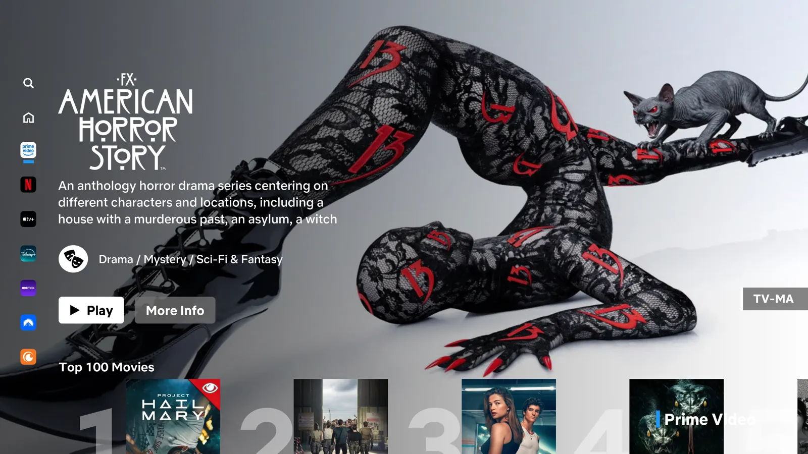<br>
      <b>Prime Video</b>
    </td>
    <td width="50%" align="center">
      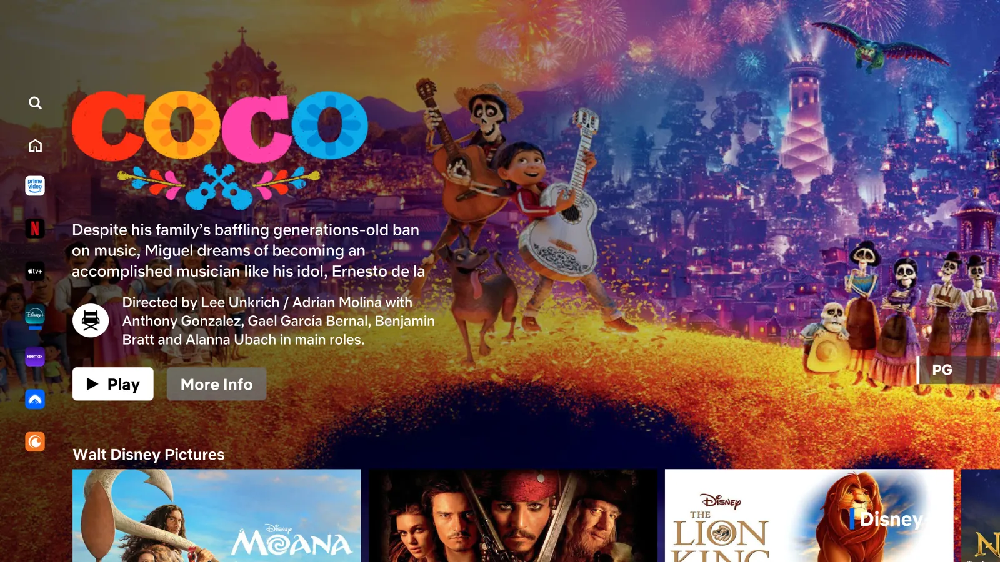<br>
      <b>Disney+</b>
    </td>
  </tr>
  <tr>
    <td width="50%" align="center">
      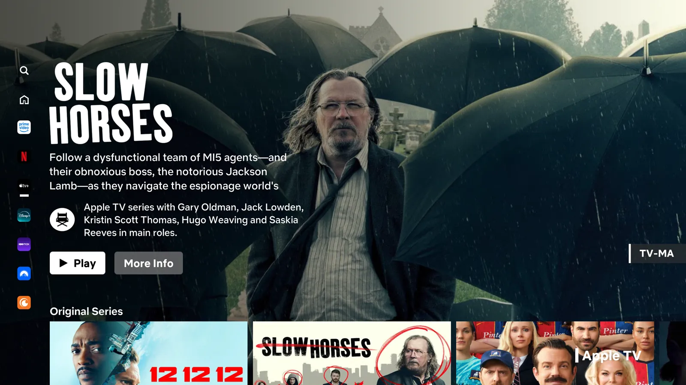<br>
      <b>Apple TV</b>
    </td>
    <td width="50%" align="center">
      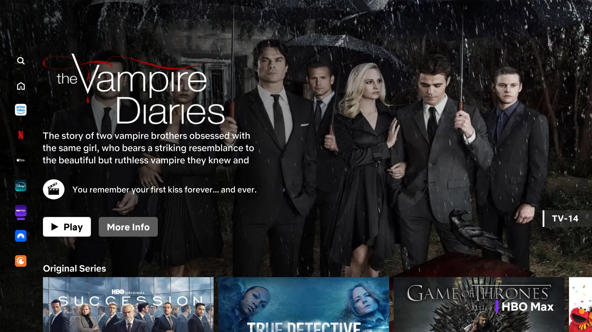<br>
      <b>HBO Max</b>
    </td>
  </tr>
  <tr>
    <td width="50%" align="center">
      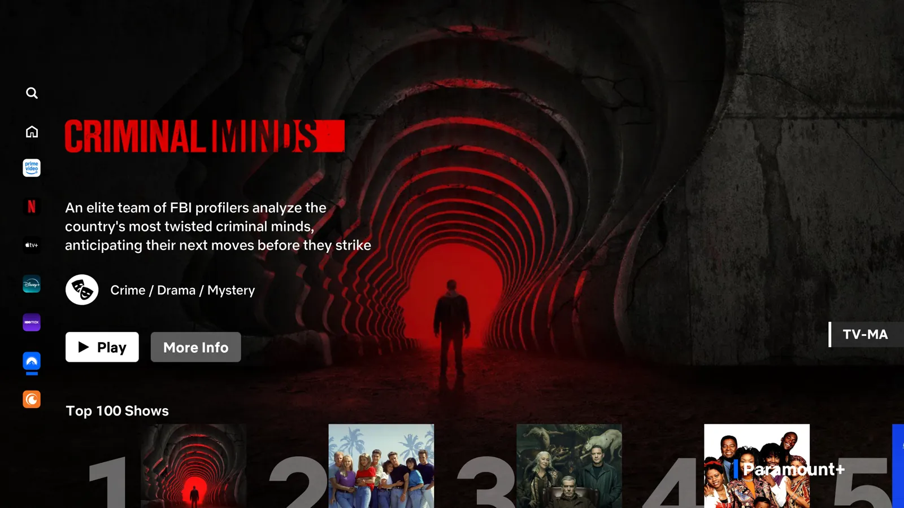<br>
      <b>Paramount+</b>
    </td>
    <td width="50%" align="center">
      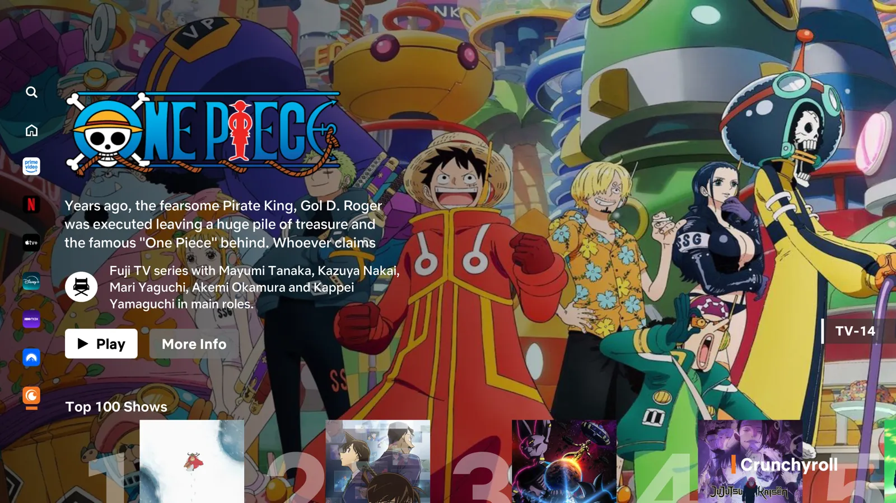<br>
      <b>Crunchyroll</b>
    </td>
  </tr>
</table>

<p align="center">
  
</p>

## Features

<table>
  <tr>
    <td width="33%" valign="top">
      <h3>Sidebar navigation</h3>
      Search, Home and seven service hubs, one press away. The sidebar opens with labels when you need it and tints itself to the hub you're in.
    </td>
    <td width="33%" valign="top">
      <h3>A Home that knows you</h3>
      Continue watching, Watch Later, recently watched and recommendations, all from your Trakt account and in sync with every device you use.
    </td>
    <td width="33%" valign="top">
      <h3>Ranked Top 100s</h3>
      Top 100 movies and shows for every service, with large ranking numerals, plus originals, new arrivals, studios and genres.
    </td>
  </tr>
  <tr>
    <td width="33%" valign="top">
      <h3>Rich title pages</h3>
      Match score, year, age rating, seasons, cast and creators, then <i>Play</i>, <i>More Episodes</i>, <i>Watch Later</i> and <i>More like this</i>, all on one page.
    </td>
    <td width="33%" valign="top">
      <h3>One-press playback</h3>
      Playback is handled by <a href="https://github.com/Unrefundable/kdmm">KDMM</a>, which installs with the skin: cached Real-Debrid or AllDebrid streams with no source lists to scroll.
    </td>
    <td width="33%" valign="top">
      <h3>Picks up where you left off</h3>
      Shows open on <i>Play Season X: Episode Y</i>, the next one you haven't seen, ready the moment the page appears.
    </td>
  </tr>
  <tr>
    <td width="33%" valign="top">
      <h3>A real startup intro</h3>
      The services' logos orbit faster and faster, burst into their colours and reveal the Deflix name, with a matching screensaver.
    </td>
    <td width="33%" valign="top">
      <h3>Made for remotes</h3>
      Focus is always where you expect it, Back always takes you where you came from, and logos stay clear of the edges TVs crop.
    </td>
    <td width="33%" valign="top">
      <h3>Guided first run</h3>
      A short setup walks you through the hubs, Trakt and KDMM. Press <i>Connect Trakt</i>, approve the code on your phone, and Home opens by itself.
    </td>
  </tr>
</table>

### Browse the way you'd expect

<table>
  <tr>
    <td width="50%" align="center">
      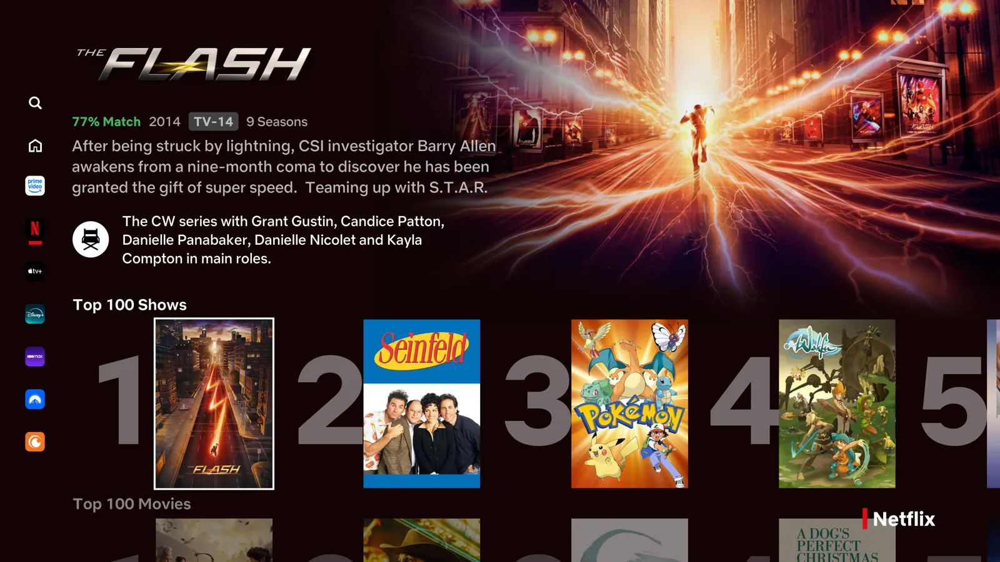<br>
      <sub><b>Ranked rows</b> · The Top 100 with big numerals</sub>
    </td>
    <td width="50%" align="center">
      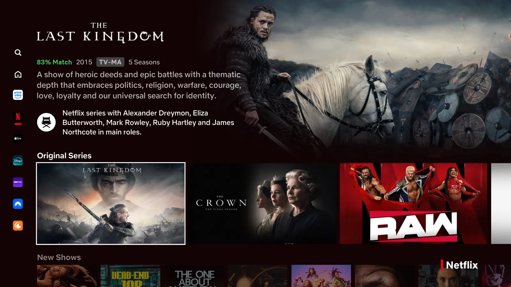<br>
      <sub><b>Landscape cards</b> · Originals, front and centre</sub>
    </td>
  </tr>
  <tr>
    <td width="50%" align="center">
      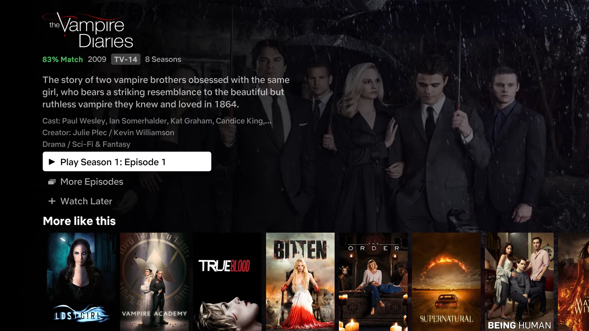<br>
      <sub><b>Title pages</b> · Everything about a show in one place</sub>
    </td>
    <td width="50%" align="center">
      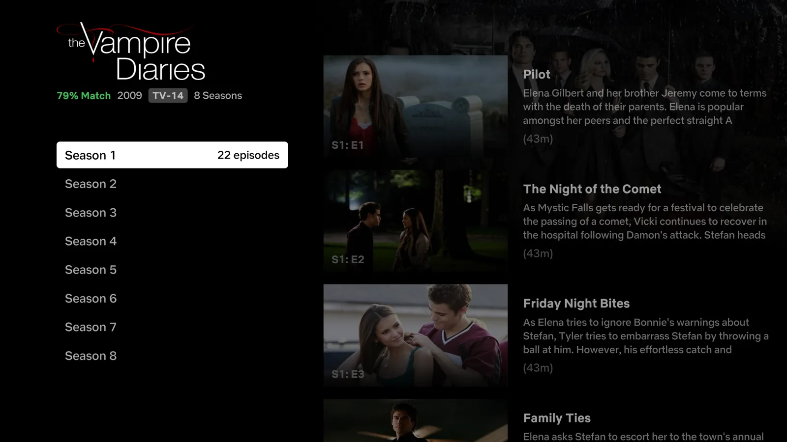<br>
      <sub><b>More Episodes</b> · Seasons, thumbnails and synopses</sub>
    </td>
  </tr>
</table>

<p align="center">
  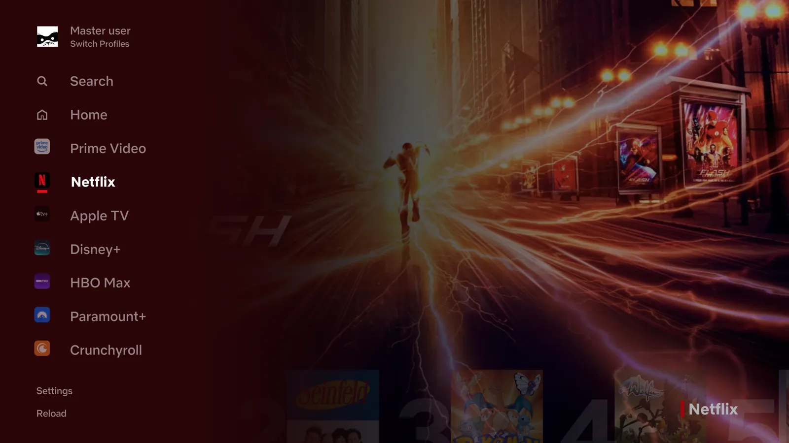<br>
  <sub><b>The sidebar</b> · Takes on the colour of the hub you're in</sub>
</p>

<p align="center">
  
</p>

## How it works

Deflix is the face; a few add-ons do the work behind it, and all of them install together.

| Piece | What it does |
|---|---|
| **Deflix** | The look: sidebar, hubs, rows, title pages, intro and screensaver |
| **TMDb Bingie Helper** | Fills every row and title page from TMDb, and your Home from Trakt |
| **[KDMM](https://github.com/Unrefundable/kdmm)** | Finds a cached release through your debrid service and plays it, with resume and next-episode playback |
| **Bingie add-ons and Skin Shortcuts** | Widgets, menus and helpers the skin is built on |

<p align="center">
  
</p>

## Installation

> [!IMPORTANT]
> Install Deflix from its **repository**, not from a zip of the skin. Only the repository brings KDMM and the other add-ons Deflix needs along with it.

1. **Add the source.** In Kodi, open **Settings › File manager › Add source**, enter the address below and name it `Deflix`:

   ```text
   https://unrefundable.github.io/Deflix/
   ```

2. **Install the repository.** Go to **Settings › Add-ons › Install from zip file › Deflix** and choose `repository.deflix-1.0.3.zip`.

   <sub>If Kodi refuses, turn on **Settings › System › Add-ons › Unknown sources** first.</sub>

3. **Install the skin.** Open **Install from repository › Deflix Repository › Look and feel › Skin › Deflix**, press **Install**, then <kbd>OK</kbd> on the list of add-ons that come with it, and say **Yes** to switching skins.

4. **Sign in twice and you're done.**
   - **Trakt**: the first-run setup shows a **Connect Trakt** button. Approve the code at trakt.tv on your phone and Home opens by itself.
   - **Real-Debrid or AllDebrid**: sign in under KDMM's settings (**Add-ons › Video add-ons › KDMM › Configure**).

Updates arrive automatically through the Deflix Repository, for the skin and for KDMM.

<p align="center">
  
</p>

## Requirements

| | |
|---|---|
| **Kodi** | 21 Omega |
| **Devices** | Anything that runs Kodi: Android TV and Google TV, Fire TV, Apple TV, Windows, macOS, Linux, LibreELEC and CoreELEC |
| **Display** | Designed for 1080p and 4K TVs (16:9) |
| **Accounts** | A free [Trakt](https://trakt.tv) account, and a [Real-Debrid](https://real-debrid.com) or [AllDebrid](https://alldebrid.com) subscription for playback |
| **Input** | A TV remote, game controller or keyboard |

<p align="center">
  
</p>

## FAQ

<details>
<summary><b>Do I need subscriptions to Netflix, Disney+ and the others?</b></summary>
<br>
No. The hubs are catalogues built from TMDb's data about what each service offers; they don't sign in to those services. Titles play through KDMM and your own debrid account.
</details>

<details>
<summary><b>Why does Kodi say a dependency couldn't be found?</b></summary>
<br>
That happens when the skin is installed from a zip on its own. Remove it, then install it from <b>Deflix Repository</b> as described in <a href="#installation">Installation</a>: the repository supplies the Bingie add-ons and KDMM.
</details>

<details>
<summary><b>Home is empty. What's wrong?</b></summary>
<br>
Home is built from your Trakt rows, so it fills in once Trakt is connected. Use <b>Connect Trakt</b> in the first-run setup, or sign in to Trakt in TMDb Bingie Helper's settings.
</details>

<details>
<summary><b>Can I use Deflix without a debrid service?</b></summary>
<br>
You can browse everything, but titles won't play: KDMM, which handles playback, streams through Real-Debrid or AllDebrid.
</details>

<details>
<summary><b>Will my old Bingie setup carry over?</b></summary>
<br>
Deflix is based on Bingie but is a separate skin with its own settings and menus. You don't need the Bingie repository or skin installed alongside it.
</details>

<p align="center">
  
</p>

## Credits

- **[Bingie](https://github.com/matke-84/skin.bingie)** by [matke-84](https://github.com/matke-84), the skin Deflix is built on, and the Bingie helper, widgets and TMDb Bingie Helper add-ons it relies on.
- **[KDMM](https://github.com/Unrefundable/kdmm)** for playback.
- **[Skin Shortcuts](https://github.com/BigNoid/script.skinshortcuts)** for the menus.
- **[TMDb](https://www.themoviedb.org)** for catalogue data and artwork, and **[Trakt](https://trakt.tv)** for watch history. This product uses the TMDb API but is not endorsed or certified by TMDb.
- Everyone who translated Bingie into other languages.

## License

Deflix is a modified version of the Bingie skin by matke-84 and its contributors. Original work copyright © matke-84 and the Bingie contributors; modifications copyright © Unrefundable.

This program is free software: you can redistribute it and/or modify it under the terms of the **GNU General Public License, version 2**, as published by the Free Software Foundation. The full text of the license is in the [LICENSE](LICENSE) file.

This program is distributed in the hope that it will be useful, but **WITHOUT ANY WARRANTY**; without even the implied warranty of **MERCHANTABILITY** or **FITNESS FOR A PARTICULAR PURPOSE**. See the GNU General Public License for more details.

**Third-party components.** Fonts, images, artwork and add-ons included with or installed alongside Deflix remain the property of their respective owners and are subject to their own licenses and terms.

**Trademarks.** Netflix, Prime Video, Apple TV, Disney+, HBO Max, Paramount+, Crunchyroll, Trakt, TMDb, Real-Debrid, AllDebrid and Kodi are trademarks of their respective owners. Their use here is solely to identify those services and does not imply any affiliation with or endorsement by them.

**Content and use.** Deflix is a user interface. It does not host, store, index or distribute any media. You are responsible for complying with the terms of service of any third-party service you connect to it and with the laws that apply where you live.

<br>

<p align="center">
  <sub><a href="AGENTS.md">Developer notes for contributors are in AGENTS.md</a></sub>
</p>
